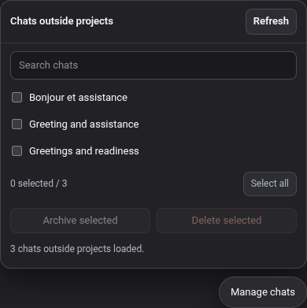

  

<h1 align="center">Mistral UserScript</h1>

Select, archive, and delete chats outside projects on chat.mistral.ai.

## Key Features

- Select multiple private chats outside projects.
- Archive or delete the selection in batches of up to 20 chats.
- Track progress and stop after the current batch.
- Uses the existing Mistral browser session; no session cookie needs to be copied.

## Installation & Setup

1. Install the Tampermonkey browser extension.
2. Create a new userscript and paste in [`mistral-bulk-chat-manager.user.js`](mistral-bulk-chat-manager.user.js).
3. Save the script and reload [chat.mistral.ai](https://chat.mistral.ai/).

## Usage

Click **Manage chats**, select chats, then choose **Archive selected** or **Delete selected**. Confirm the action when prompted.

## Known Issues

Mistral may change its internal API, which could require updates to the userscript.

The Mistral logo is a trademark of [Mistral AI](https://mistral.ai/brand/).
